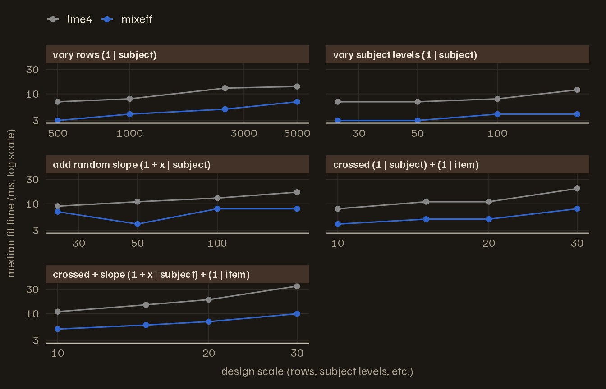
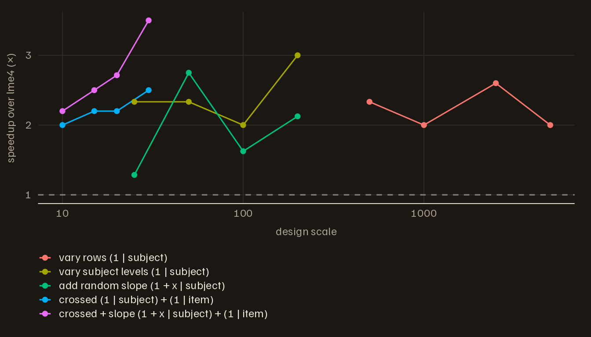
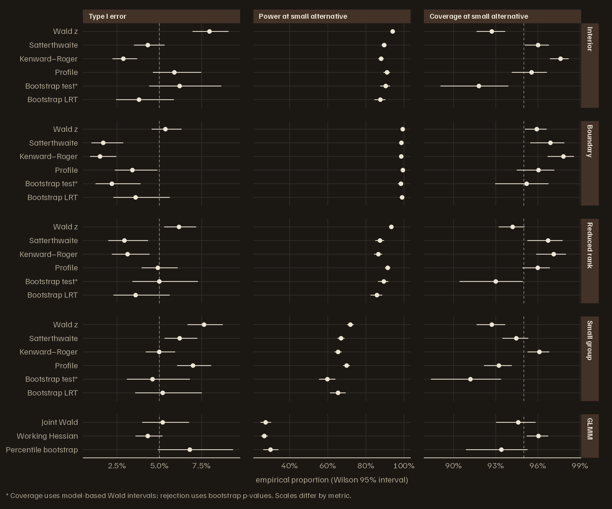

# Benchmarking mixeff

``` r

library(mixeff)
```

Bootstrap and simulation studies can require thousands of model fits. A
1,000-replicate bootstrap takes roughly 1,000 refits in addition to the
original analysis, so even a small saving per fit can reduce the total
runtime. This article reports fitting times and inference results from
the benchmarks shipped with the package, and shows how to rerun them.

On the LMM scaling benchmark shipped with the package, `mixeff` ran 2.0
to 3.5 times faster than `lme4` at the largest tested scale of each
design (1.3 to 3.5 across the whole grid). This vignette shows the
figures from a single run of that benchmark and then documents the
harness used to make them. The numbers are machine- and model-dependent
— all of these fits complete in tens of milliseconds — so the scripts
also write CSV files that you can re-plot and rerun on the designs you
actually care about.

## Fitting times

The benchmark sweeps five mixed-model designs — varying rows, varying
subject levels, adding random slopes, crossing subject and item, and
combining crossed grouping with a random slope — across a log-spaced
grid of scale values. At each cell,
[`mixeff::lmm()`](https://bbuchsbaum.github.io/mixeff/reference/lmm.md)
and [`lme4::lmer()`](https://rdrr.io/pkg/lme4/man/lmer.html) fit the
same model five times. The summary table records median elapsed seconds
and speedup over `lme4` per cell. The shipped CSV comes from one run on
2026-07-30: macOS arm64 (M-series), R 4.5.1, mixeff 0.2.0 built with the
release profile, engine snapshot `4a2abb3`. If any of those differ on
your machine, rerun the harness rather than reusing these numbers.

``` r

benchmark_path <- system.file(
  "extdata", "lme4-scaling-summary.csv",
  package = "mixeff"
)
benchmark <- read.csv(benchmark_path, stringsAsFactors = FALSE)

benchmark$scenario_label <- factor(
  benchmark$scenario,
  levels = c("rows", "groups", "slopes", "crossed", "crossed_slope"),
  labels = c(
    "vary rows (1 | subject)",
    "vary subject levels (1 | subject)",
    "add random slope (1 + x | subject)",
    "crossed (1 | subject) + (1 | item)",
    "crossed + slope (1 + x | subject) + (1 | item)"
  )
)

head(benchmark[, c("scenario", "scale_value", "engine",
                   "median_sec", "speedup_vs_lme4")])
#>   scenario scale_value engine median_sec speedup_vs_lme4
#> 1  crossed          10   lme4      0.008             1.0
#> 2  crossed          10 mixeff      0.004             2.0
#> 3  crossed          15   lme4      0.011             1.0
#> 4  crossed          15 mixeff      0.005             2.2
#> 5  crossed          20   lme4      0.011             1.0
#> 6  crossed          20 mixeff      0.005             2.2
```

The first figure plots the median fit time against design scale, on
log-log axes, with one panel per scenario. `mixeff` took less time than
`lme4` at every tested setting. The largest speedup is on the one design
that combines crossed grouping with a random slope; the other four
designs do not order by structural complexity (the plain grouped random
intercept ranks second).

``` r

library(ggplot2)

ggplot(benchmark,
       aes(scale_value, median_sec * 1000, colour = engine,
           group = engine)) +
  geom_line() +
  geom_point() +
  facet_wrap(~ scenario_label, scales = "free_x", ncol = 2) +
  scale_x_log10() +
  scale_y_log10() +
  scale_colour_manual(values = c(lme4 = "#888888", mixeff = "#3366cc")) +
  labs(
    x = "design scale (rows, subject levels, etc.)",
    y = "median fit time (ms, log scale)",
    colour = NULL
  ) +
  theme(text = element_text(size = 11),
        legend.position = "top",
        panel.grid.minor = element_blank())
```




The second figure shows the speedup of `mixeff` over `lme4` at each
cell. The dashed reference line at 1× would mean the two engines are
equally fast.

``` r

mixeff_rows <- subset(benchmark, engine == "mixeff")

ggplot(mixeff_rows,
       aes(scale_value, speedup_vs_lme4,
           colour = scenario_label, group = scenario_label)) +
  geom_hline(yintercept = 1, linetype = 2, colour = "grey50") +
  geom_line() +
  geom_point() +
  scale_x_log10() +
  scale_y_continuous(breaks = seq(0, 8, by = 1)) +
  labs(
    x = "design scale",
    y = "speedup over lme4 (×)",
    colour = NULL
  ) +
  theme(text = element_text(size = 11),
        legend.position = "bottom",
        legend.direction = "vertical",
        panel.grid.minor = element_blank()) +
  guides(colour = guide_legend(ncol = 1))
```




Two caveats before reading the speedup figure. First, the absolute
timings run from about 3 ms to 35 ms and the recorded medians are whole
milliseconds, so timer resolution alone can move a ratio substantially —
one millisecond on the 4 ms side of a 12 ms / 4 ms cell moves the ratio
from 3.0 to 2.4 or 4.0; five replications per cell do little to smooth
that. Second, within a single design the speedup does not trend reliably
with scale.

## Choosing what to time

There are two separate speed questions.

First, measure model fitting. This asks how quickly each engine solves
the same mixed model as the number of rows, groups, slopes, or crossed
random effects changes.

Second, measure complete bootstrap calculations, including simulation,
refitting, and the final inference summary.

``` r

data.frame(
  bootstrap_replicates = c(50L, 200L, 1000L),
  approximate_refits = c(50L, 200L, 1000L)
)
#>   bootstrap_replicates approximate_refits
#> 1                   50                 50
#> 2                  200                200
#> 3                 1000               1000
```

## Running the fitting benchmark

Use the scaling benchmark when you want to compare
[`mixeff::lmm()`](https://bbuchsbaum.github.io/mixeff/reference/lmm.md)
with [`lme4::lmer()`](https://rdrr.io/pkg/lme4/man/lmer.html) over
several synthetic LMM designs.

``` r

system2(
  "Rscript",
  c(
    "inst/benchmarks/lme4-scaling.R",
    "--reps=5",
    "--scenarios=rows,groups,slopes,crossed",
    "--no-plots"
  )
)
```

That script writes one row per engine, design, scale value, and timing
repetition, plus a summary table with median elapsed seconds and speed
relative to `lme4`.

``` r

data.frame(
  file = c(
    "benchmarks/lme4-scaling/lme4-scaling-raw.csv",
    "benchmarks/lme4-scaling/lme4-scaling-summary.csv"
  ),
  contents = c(
    "one timing row per engine/design/repetition",
    "median seconds, fits per second, and relative speed"
  )
)
#>                                               file
#> 1     benchmarks/lme4-scaling/lme4-scaling-raw.csv
#> 2 benchmarks/lme4-scaling/lme4-scaling-summary.csv
#>                                              contents
#> 1         one timing row per engine/design/repetition
#> 2 median seconds, fits per second, and relative speed
```

## Running the bootstrap benchmark

Use the bootstrap benchmark when you want to time the bootstrap and
simulation-based inference routes themselves.

``` r

system2(
  "Rscript",
  c(
    "inst/benchmarks/bootstrap-inference.R",
    "--nsim=200",
    "--reps=3"
  )
)
```

The benchmark includes `test_effect(method = "bootstrap")`,
`confint(method = "bootstrap")`, `compare(method = "bootstrap")`, and
[`lme4::bootMer()`](https://rdrr.io/pkg/lme4/man/bootMer.html) as an
R-engine baseline. If `pbkrtest` is installed, it also times
[`pbkrtest::PBmodcomp()`](https://rdrr.io/pkg/pbkrtest/man/pb__modcomp.html).

``` r

data.frame(
  route = c(
    "mixeff_test_effect_bootstrap",
    "mixeff_confint_bootstrap",
    "mixeff_compare_bootstrap_lrt",
    "lme4_bootMer_fixef_distribution",
    "pbkrtest_PBmodcomp"
  ),
  target = c(
    "term-level fixed-effect p-value",
    "fixed-effect confidence interval",
    "model comparison p-value",
    "fixed-effect bootstrap distribution",
    "parametric bootstrap model comparison"
  )
)
#>                             route                                target
#> 1    mixeff_test_effect_bootstrap       term-level fixed-effect p-value
#> 2        mixeff_confint_bootstrap      fixed-effect confidence interval
#> 3    mixeff_compare_bootstrap_lrt              model comparison p-value
#> 4 lme4_bootMer_fixef_distribution   fixed-effect bootstrap distribution
#> 5              pbkrtest_PBmodcomp parametric bootstrap model comparison
```

## Inference accuracy and runtime

To assess an inference method, measure its Type I error, power, and
interval coverage as well as its runtime. The simulation study below
estimates these rates under a null hypothesis and a small alternative.

The shipped artifact was regenerated in **release mode** at R candidate
`00297b3` and engine pin `977ef11`. These historical results do not
establish calibration at the current engine pin. The study used 2,500
replications per analytic route (Monte Carlo SE at a true 0.05 rate:
about 0.0044), 500 per bootstrap route (about 0.0097), and 1,000 for the
joint-Laplace GLMM route. Every rate below carries a Wilson 95%
interval, and every cell records requested, evaluated, refused, failed,
and boundary replicate counts. The study covers four Gaussian LMM
regimes (interior, boundary, reduced-rank, small-group) and one binomial
GLMM fixture with three routes (joint Wald, the opt-in working-Hessian
approximation, and the parametric bootstrap). The results apply to these
simulated regimes. Crossed effects, rare events, and overdispersed
outcomes require further study.

The artifact’s provenance (package commit, engine pin, lockfile
checksum, exact invocation, seeds) ships next to it as a manifest:

``` r

locate_extdata <- function(file) {
  path <- system.file("extdata", file, package = "mixeff")
  if (nzchar(path)) return(path)
  local_path <- file.path("inst", "extdata", file)
  if (file.exists(local_path)) local_path else file.path("..", "..", local_path)
}
simulation <- read.csv(locate_extdata("inference-method-simulation-summary.csv"),
                       stringsAsFactors = FALSE)
manifest <- jsonlite::read_json(
  locate_extdata("inference-method-simulation-manifest.json")
)
cat(sprintf(
  "mode: %s | analytic reps: %d | bootstrap reps: %d | joint reps: %d\npackage %s @ %.9s | engine %.9s\nreproduce: %s\n",
  manifest$mode, manifest$reps_analytic, manifest$reps_bootstrap,
  manifest$reps_joint, manifest$package_version, manifest$package_commit,
  manifest$rust_pin, manifest$invocation
))
#> mode: release | analytic reps: 2500 | bootstrap reps: 500 | joint reps: 1000
#> package 0.2.0 @ 00297b319 | engine 977ef1121
#> reproduce: Rscript inst/benchmarks/inference-method-simulation.R --mode=release --reps=2500 --reps-bootstrap=500 --reps-joint=1000 --nsim=199 --seed=2026
```

The run completed all 27 cells with no outer fitting or evaluation
errors, but several routes departed from nominal performance:

- Interior LMM Wald tests rejected 7.96% of null replications (95%
  Wilson interval 6.96–9.09%) at a nominal 5% level. Their interval
  coverage was 92.72% (91.63–93.67%) at a nominal 95% level. Small-group
  Wald results showed a similar shortfall.
- Kenward–Roger was conservative among evaluated interior fits: 2.88%
  rejection (2.24–3.69%). Boundary and reduced-rank Satterthwaite and
  Kenward–Roger cells also had low conditional rejection rates and many
  refusals. Availability matters: interior profile intervals were
  returned for only 1,053 of 2,500 null replications.
- The LMM bootstrap row’s derived intervals covered 91.8% of interior
  alternatives (89.1–93.9%) and 91.2% of small-group alternatives
  (88.4–93.4%). These intervals use the contrast estimate plus or minus
  a normal quantile times the original model-based standard error. Only
  that row’s p-value comes from the bootstrap. Its coverage does not
  measure the percentile intervals returned by
  `confint(method = "bootstrap")`.
- On this binomial fixture, joint Wald rejection was 5.2% (3.99–6.76%)
  and coverage was 94.6% (93.02–95.84%). GLMM percentile-bootstrap
  rejection was 6.8% (4.91–9.35%) and coverage was 93.4% (90.88–95.26%).
  These intervals include the respective nominal rates; they do not
  establish calibration for other GLMM designs.

These are pointwise intervals across multiple cells, not a familywise
test or a universal qualification rule. A completed study does not
certify every route. The working-Hessian approximation remains
exploratory even where its rates look favorable in this fixture.

The plot shows each route’s empirical rates with their Wilson intervals.
P-value routes contribute Type I error and power; interval routes
contribute coverage. Rates are conditional on a successful evaluation;
the CSV also carries unconditional Type I error and power, using all
requested replications as the denominator, and the full replicate
accounting. A low unconditional rejection rate can reflect refusals; it
does not establish good inference. An evaluated replicate means the
public route returned a usable result; optimizer certification rates and
the inner bootstrap-refit accounting are not separately tabulated in
this summary. Boundary counts identify the recorded
boundary/reduced-rank fit statuses and overlap the evaluation counts.
Routes that did not run carry an explicit `reason` — “excluded in this
mode” is machine-distinguishable from “not wired”.

``` r

library(ggplot2)

metric_frame <- function(d, value, lower, upper, label) {
  out <- d[, c("method", "fixture", value, lower, upper)]
  names(out) <- c("method", "fixture", "value", "lower", "upper")
  out$metric <- label
  out
}
simulation_long <- rbind(
  metric_frame(ran, "type_I_error", "type_I_lower", "type_I_upper",
               "Type I error"),
  metric_frame(ran, "power_at_alt", "power_lower", "power_upper",
               "Power at small alternative"),
  metric_frame(ran, "coverage_at_alt", "coverage_lower", "coverage_upper",
               "Coverage at small alternative")
)
simulation_long <- subset(simulation_long, is.finite(value))
simulation_long$metric <- factor(
  simulation_long$metric,
  levels = c("Type I error", "Power at small alternative",
             "Coverage at small alternative")
)
simulation_long$fixture <- factor(simulation_long$fixture,
                                  levels = unique(ran$fixture))
simulation_long$method <- factor(simulation_long$method,
                                 levels = rev(unique(ran$method)))
nominal <- data.frame(
  metric = factor(c("Type I error", "Coverage at small alternative"),
                  levels = levels(simulation_long$metric)),
  y = c(0.05, 0.95)
)

ggplot(simulation_long, aes(value, method)) +
  geom_vline(data = nominal, aes(xintercept = y), linetype = 2,
             linewidth = 0.3, colour = "grey40") +
  geom_pointrange(aes(xmin = lower, xmax = upper), linewidth = 0.4,
                  fatten = 1.5, orientation = "y") +
  facet_grid(fixture ~ metric, scales = "free", space = "free_y",
             labeller = labeller(fixture = c(interior = "Interior",
               boundary = "Boundary", reduced_rank = "Reduced rank",
               small_group = "Small group", glmm_binomial = "GLMM"))) +
  scale_x_continuous(labels = function(x) paste0(format(100 * x, trim = TRUE), "%")) +
  scale_y_discrete(labels = c(
    asymptotic_wald_z = "Wald z", satterthwaite = "Satterthwaite",
    kenward_roger = "Kenward–Roger", profile = "Profile",
    bootstrap = "Bootstrap test*", bootstrap_lrt = "Bootstrap LRT",
    glmm_wald_joint_laplace = "Joint Wald",
    wald_z_working_hessian = "Working Hessian",
    glmm_parametric_bootstrap = "Percentile bootstrap"
  )) +
  labs(x = "empirical proportion (Wilson 95% interval)", y = NULL,
       caption = "* Coverage uses model-based Wald intervals; rejection uses bootstrap p-values. Scales differ by metric.") +
  theme(text = element_text(size = 10),
        panel.grid.minor = element_blank())
```




## Interpreting timing ratios

For a local speed claim, read the summary CSV and compute ratios from
elapsed seconds. Values above 1 mean the baseline route took longer than
the `mixeff` route.

``` r

summary <- read.csv("benchmarks/bootstrap-inference/bootstrap-inference-summary.csv")
mixeff_ci <- subset(summary, route == "mixeff_confint_bootstrap")
lme4_boot <- subset(summary, route == "lme4_bootMer_fixef_distribution")

data.frame(
  comparison = "lme4 bootMer / mixeff bootstrap CI",
  speedup = lme4_boot$median_sec / mixeff_ci$median_sec
)
```

The ratio applies to the measured conditions. It depends on the formula,
optimizer, random-effects structure, `nsim`, and machine. The point of
the benchmark scripts is to make the claim reproducible for the model
class you are actually fitting.

## Reporting a benchmark

When you report benchmark results, include the model formula, number of
rows, number of grouping levels, random-effects structure, `nsim`,
repetitions, and the package versions. The raw CSV has the timing rows;
the summary CSV is for tables and figures.

``` r

data.frame(
  field = c("formula", "nobs", "groups", "random_terms", "nsim", "reps", "versions"),
  reason = c(
    "defines the fixed and random structure being refit",
    "controls the amount of data processed per fit",
    "controls the random-effect dimension",
    "controls covariance structure and optimizer work",
    "controls bootstrap cost",
    "shows timing stability",
    "makes the run reproducible"
  )
)
#>          field                                             reason
#> 1      formula defines the fixed and random structure being refit
#> 2         nobs      controls the amount of data processed per fit
#> 3       groups               controls the random-effect dimension
#> 4 random_terms   controls covariance structure and optimizer work
#> 5         nsim                            controls bootstrap cost
#> 6         reps                             shows timing stability
#> 7     versions                         makes the run reproducible
```
